<div align="center">


# DrexiusTerminal

**A local-first, secure, open-source terminal workspace — and a Termius alternative.**

Terminals, SSH & SFTP, serial ports, tunnels, an encrypted SQLCipher vault, and a
multi-provider AI copilot — on your desktop, on your phone, and entirely under your control.

[](https://github.com/DreyDreamer17/drexius-terminal)
[](./LICENSE)
[](https://tauri.app)
[](https://react.dev)
[](https://tailwindcss.com)


</div>

<p align="center">
  <a href="#screenshots">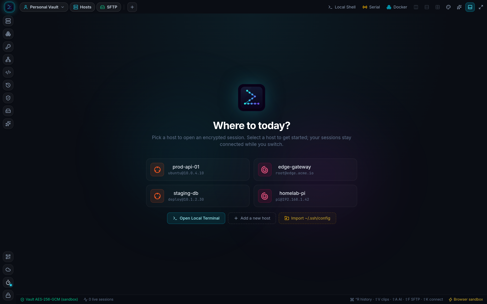</a>
</p>

<p align="center"><sub>
  Every screenshot below is the real application, captured from the browser-preview build.
</sub></p>

---

## Try it in 60 seconds

DrexiusTerminal ships a **browser preview** — a full demo sandbox that runs with no native
toolchain, no account, and no server. It is the same React UI, wired to a simulated shell,
a virtual filesystem, and a WebCrypto-encrypted vault held in `localStorage`.

```bash
git clone https://github.com/DreyDreamer17/drexius-terminal.git
cd drexius-terminal
npm install
npm run dev
```

Open <http://localhost:5173>, create a vault with any password, and you are in. Nothing
leaves your machine.

> The browser preview is a **demo**, not a security boundary: it encrypts the demo vault with
> WebCrypto AES-256-GCM in `localStorage` and runs SSH sessions in a local sandbox. Build the
> Tauri app for real connections, the OS keychain, and the SQLCipher vault.

For the real thing — real SSH, real keychain, real vault file:

```bash
npm run tauri:dev      # desktop app
npm run tauri:build    # installable bundle
```

---

## Screenshots

| | |
|---|---|
| **Vault-first entry** — the app opens on a locked vault. A master password never touches disk in the clear, and a one-time Emergency Recovery Key is generated for you.<br>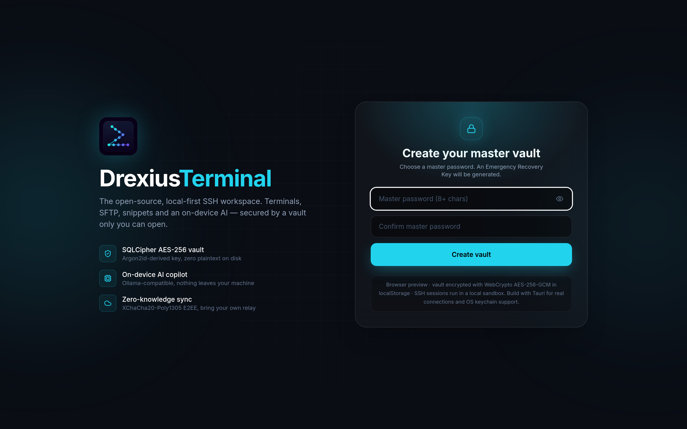 | **Encrypted relay sync** — bring your own relay. The seed is a random 32 bytes inside SQLCipher, never password-derived, and the relay only ever sees ciphertext.<br>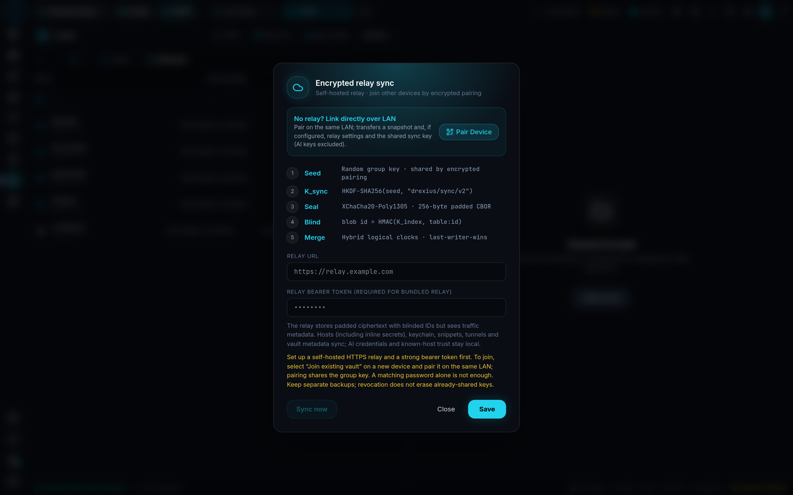 |
| **One workspace, many protocols** — multi-pane splits, jump hosts, local PTY, serial UART and tunnels, all in a single tab bar.<br>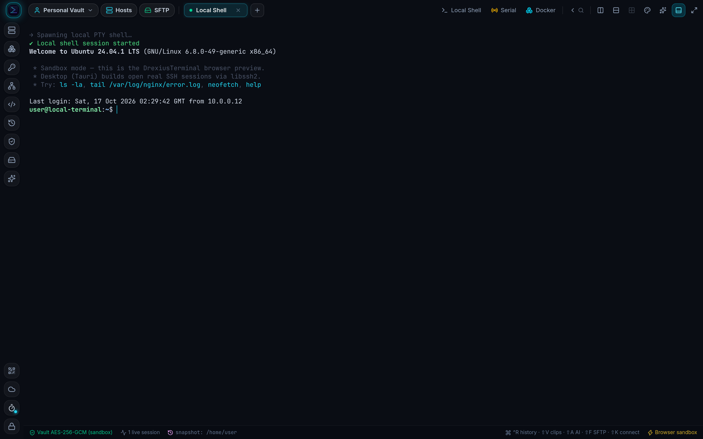 | **A copilot that reads your terminal** — Ollama-compatible, risk-classified suggestions, and secrets scrubbed before anything is sent.<br>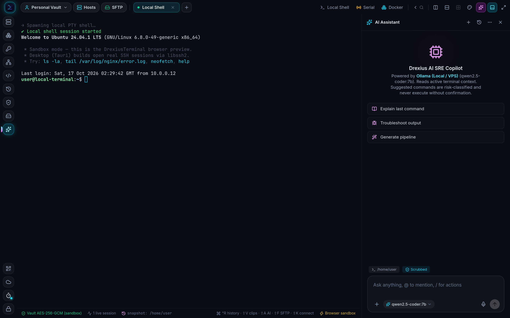 |
| **Hosts and secrets, vault-backed** — profiles, groups, inline secrets and reusable identities, encrypted at rest.<br>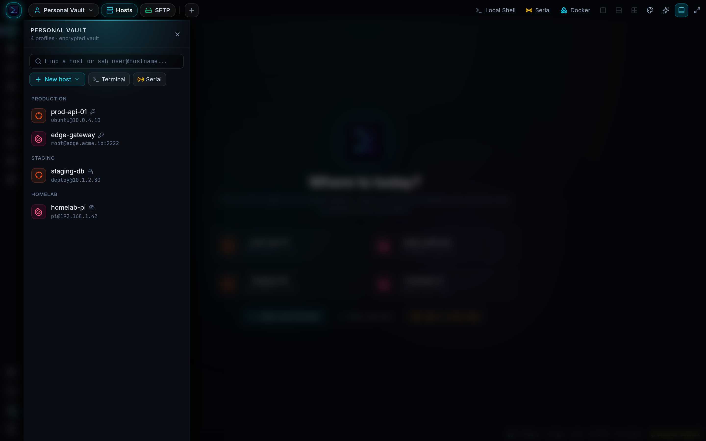 | **SFTP without the terminal** — a graphical remote and local file manager, with a code editor, transfer queue and wrapped-line editing.<br>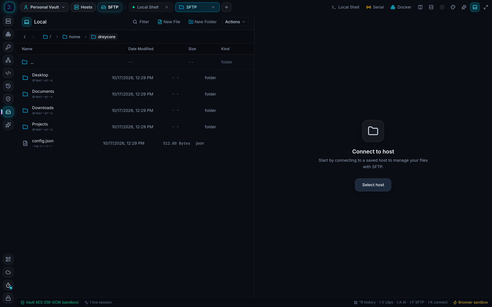 |
| **Pair a device over the LAN** — X25519 key exchange plus a 6-digit PIN. The PIN is only an HKDF salt and is never transmitted.<br>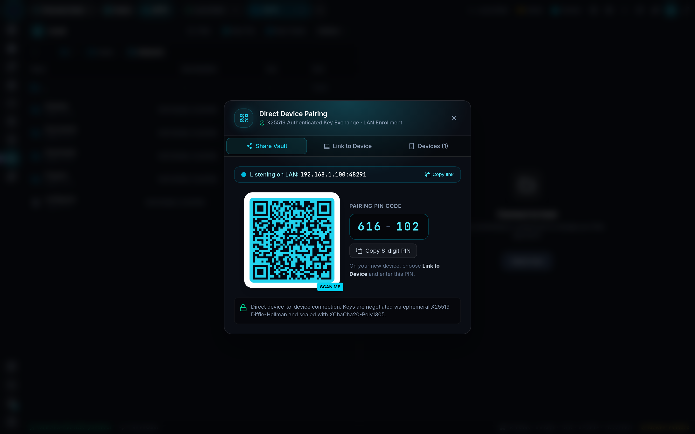 | **Recovery you control** — a 128-bit Emergency Recovery Key, shown once, downloadable, and never stored in the clear.<br>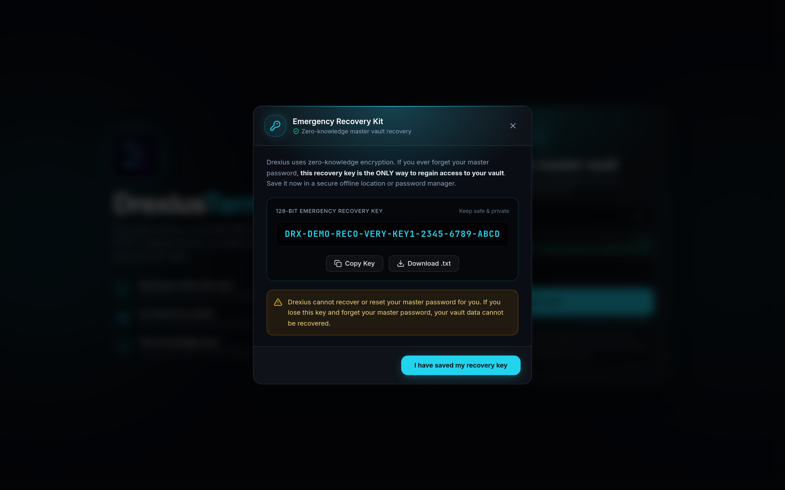 |

### Mobile experience

**Mobile is a first-class layout, not a squeeze.** Below 768 px the workspace becomes a
five-tab app: a Termius-style full-screen terminal with a session bar and an extended
keypad, bottom drawers for AI, snippets, keypad and history, pinch-to-zoom font sizing,
long-press word selection with draggable handles, and CTRL/ALT latches.

Native Android builds and the mobile shell, its capabilities and the
physical-device release checklist are documented in **[docs/mobile-ui.md](docs/mobile-ui.md)**.

| Mobile Vault Unlock | Host & Identity Manager | Full-Screen Terminal |
|:---:|:---:|:---:|
| 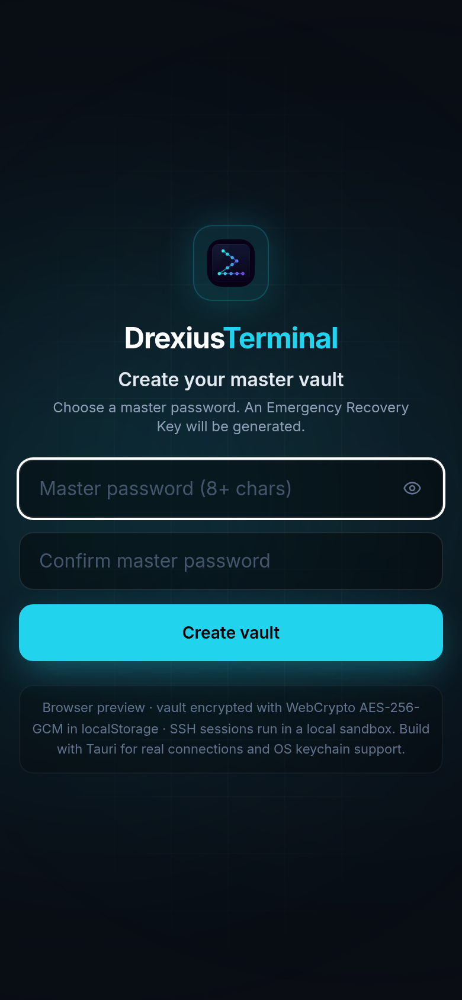 | 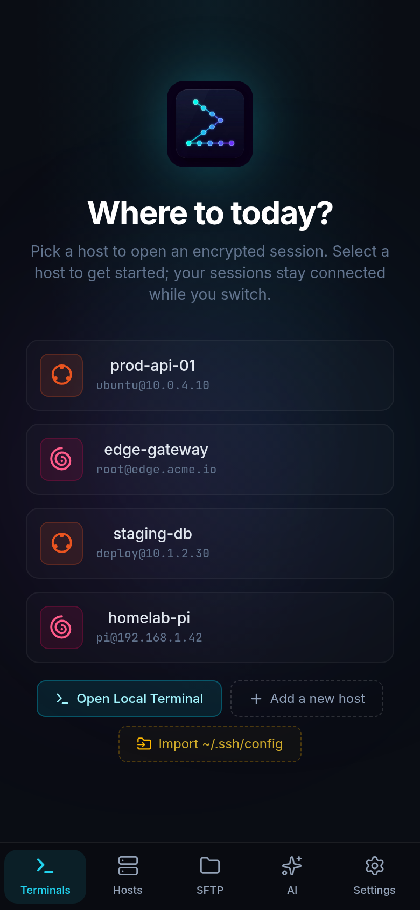 | 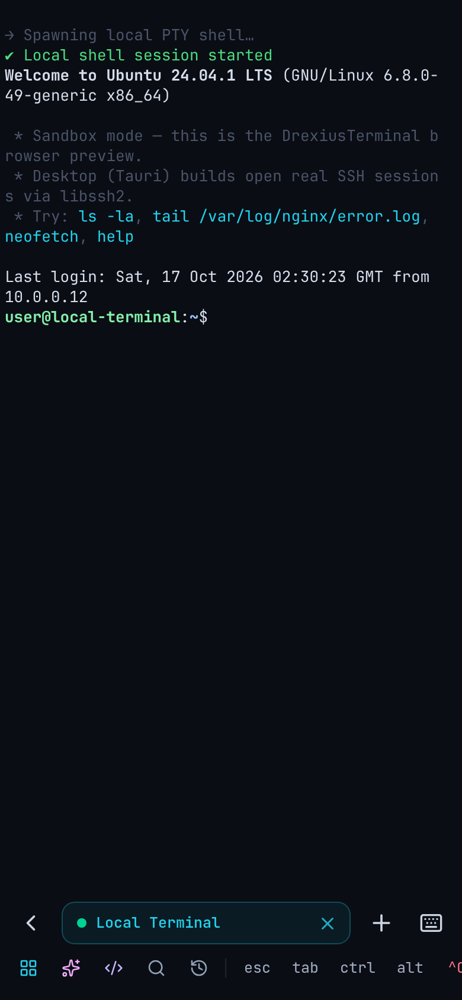 |
| *Touch-friendly master vault unlock* | *Quick connect, identities & saved hosts* | *Accessory keypad, session bar & virtual keys* |


---

## What you get

### Terminal engine

Full **xterm.js 6** with the WebGL renderer (automatic DOM fallback on context loss),
bracketed paste, OSC-7 cwd tracking, session auto-resume, ghost-text autosuggestions,
reverse search, a searchable scrollback, and broadcast input across every open pane.

### Protocols and shells

| | |
|---|---|
| **SSH & jump hosts** | One dedicated OS thread per session via libssh2, fail-closed TOFU host-key verification, keep-alive monitoring, multi-hop `ProxyJump`. |
| **SFTP** | Its own blocking connection, so a 2 GB transfer never stalls the interactive shell. |
| **Local PTY** | Native local shells via `portable-pty`, with automatic child reaping. |
| **Serial UART** | Real hardware serial ports via `serialport` — baud rate, data bits, parity, stop bits. |
| **Port forwarding** | Local, remote (reverse) and dynamic SOCKS5 tunnels, including an SSH-tunnelled proxy for AI traffic. |

### Infrastructure integrations

- **Tailscale** — discover tailnet devices from the local `tailscale` CLI or the Tailscale
  REST API, and import them as host profiles in one step.
- **Docker** — list containers, run lifecycle actions and read logs, on the local machine or
  on any saved SSH host.

### Security and the encrypted vault

- **SQLCipher AES-256 store** — PBKDF2 deliberately bypassed in favour of a high-memory
  **Argon2id** key derivation; the derived key is handed to SQLCipher as a raw hex key.
- **OS keychain integration** — optional master-password storage in macOS Keychain,
  Windows Credential Manager or Linux Secret Service, with biometric unlock. Opt-in only,
  and never probed on startup.
- **Secret hygiene** — pattern-based redaction across command history, session snapshots
  and clipboard ingestion, so secrets do not end up in the wrong place.
- **LAN enrollment and relay sync** — X25519 + HKDF + XChaCha20-Poly1305 pairing, and a
  self-hosted relay for ongoing sync that only ever sees ciphertext.
- **Multi-vault and team bundles** — partition personal and team workspaces, and export
  encrypted `.nxvault` bundles that never leak AI settings.

### AI workspace and OpenCode

- **Multi-provider relay** — Ollama, any OpenAI-compatible API (OpenAI, DeepSeek, Groq,
  OpenRouter, custom), Anthropic, and Google Gemini.
- **Credentials that stay in Rust** — provider keys and proxy credentials live in the
  encrypted vault and are injected by the Rust relay, so the request path never carries a
  key from the WebView.
- **OpenCode agent integration** — background runs through the OpenCode CLI, locally or
  over SSH, in an isolated scratch workspace with deny-by-default tool permissions.

---

## How the security model works

The desktop app stores the vault in SQLCipher and handles SSH connections and AI HTTP
requests in **Rust**. The WebView is *not* a secret-free boundary: master passwords and
recovery codes are entered and displayed there, and host credentials are typed into
React forms. Vault *storage* and SSH *authentication* live in Rust, but the WebView must
be treated as trusted application code.

1. **Host verification** — unknown host keys require explicit approval; changed keys are
   rejected outright.
2. **AI credentials** — stored in SQLCipher and injected by the Rust relay, which
   verifies the configured provider origin before attaching a pooled credential.
3. **Master password** — *choosing* a password (creating a vault, or setting one through
   recovery) requires 8+ characters, enforced in the backend as well as the lock screen.
   *Unlocking* an existing vault keeps a lower floor on purpose, so a vault created by an
   older build can never be locked out by an upgrade.
4. **Destination policy** — the AI relay refuses loopback, RFC1918, link-local, CGNAT,
   multicast and other non-public targets, and **pins** the connection to the addresses it
   validated, so a name cannot be re-resolved to a private address between check and
   connect.
5. **OpenCode policy** — the agent runs with deny-by-default permissions, and the glob
   order of the permission template is load-bearing.

The full threat model, trust boundaries, disclosure policy and known limitations live in
**[docs/SECURITY.md](docs/SECURITY.md)**.

### Sync and pairing limitations

- LAN pairing sends a **one-time snapshot**. If the source has a relay configured, the
  encrypted transfer also enrolls a new, empty vault into its sync group (stable shared
  seed, relay URL and token). The new device has its **own local master password**.
  Pairing includes host and keychain credentials, snippets, tunnels and AI provider
  configuration **without API keys or proxy URLs**. A revoked device keeps data it
  already received.
- Ongoing relay sync requires a **[self-hosted relay](relay/README.md)**; no Drexius-hosted
  service exists. Independently created vaults — even with identical passwords — cannot
  read each other's encrypted blobs: use **Join existing vault** during setup. Synced
  tables are hosts (**including inline host secrets**), keychain, snippets, tunnels and
  vault metadata. AI configs and known-host trust stay local. The relay sees ciphertext
  plus traffic metadata; it cannot stop a device that already holds the group seed from
  reading previously synced data.
- This is an initial implementation, **not a substitute for backups**: conflict resolution
  is record-level last-writer-wins, compromised-device revocation does not rotate the
  group seed, and recovery from losing every enrolled device is not yet supported. Team
  bundles exclude AI configurations and are separate from pairing and relay sync.

---

## Documentation

| Document | What it covers |
|---|---|
| **[ARCHITECTURE.md](ARCHITECTURE.md)** | The authoritative design document: trust boundaries, SSH data path, snapshotting, vaults and sync, AI request flow, OpenCode & serial, Tailscale & Docker, and the known limitations of each. |
| **[docs/SECURITY.md](docs/SECURITY.md)** | Threat model, what is and is not protected, secret-handling rules, disclosure policy, and a per-layer security checklist. |
| **[docs/SYNC.md](docs/SYNC.md)** | Running your own relay, pairing a device, key and token rotation, backups, and the exact semantics of what syncs. |
| **[docs/AI.md](docs/AI.md)** | Provider setup, key pools and failover, proxies, prompt hygiene and redaction, the risk classifier, and the OpenCode agent. |
| **[docs/DEVELOPMENT.md](docs/DEVELOPMENT.md)** | Repository layout, prerequisites, the full test matrix, browser-preview and Tauri workflows, and how releases are built and signed. |
| **[docs/mobile-ui.md](docs/mobile-ui.md)** | The responsive shell: architecture, automated checks, and the physical-device release checklist. |
| **[docs/FAQ.md](docs/FAQ.md)** | Common questions and troubleshooting, from "why is my key masked?" to "why did my SFTP transfer stall?". |
| **[relay/README.md](relay/README.md)** | Operating the reference relay implementation. |

---

## Building from source

### Prerequisites

- **Node.js** 20 or later (22.6+ for the mobile unit runner)
- **Rust** 1.77 or later
- **System libraries (Linux)**
  ```bash
  # Debian / Ubuntu / Mint
  sudo apt-get install -y libwebkit2gtk-4.1-dev build-essential curl wget file \
    libxdo-dev libssl-dev libayatana-appindicator3-dev librsvg2-dev

  # Arch Linux / Manjaro
  sudo pacman -S --needed webkit2gtk-4.1 base-devel curl wget openssl
  ```

### Commands

| Command | What it does |
|---|---|
| `npm run dev` | Vite dev server with the browser-preview sandbox. |
| `npm run tauri:dev` | The real desktop app against a live Rust backend. |
| `npm run typecheck` | `tsc --noEmit` across the frontend. |
| `npm run test:mobile` | Node unit tests for the mobile accessory-key pipeline. |
| `npm run test:mobile-ui` | Browser regression suite (needs `CHROMIUM_PATH`). |
| `npm run build` | Typecheck, then bundle the frontend into `dist/`. |
| `npm run tauri:build` | Produce installable desktop bundles. |
| `python3 -m unittest discover -s relay` | Run the reference relay's unit tests. |

The Rust core has its own suite — `cd src-tauri && cargo test --locked` — which is the only
place the vault, SSH and AI-relay behaviour is actually verified. See
[docs/DEVELOPMENT.md](docs/DEVELOPMENT.md) for the full matrix.

---

## Contributing

Issues and pull requests are welcome. Please read
[docs/DEVELOPMENT.md](docs/DEVELOPMENT.md) first — it describes the repository layout, the
checks that must pass, and the conventions the Rust core follows.

Security reports are handled privately; please do not open a public issue for a
vulnerability. See [docs/SECURITY.md](docs/SECURITY.md#7-reporting-a-vulnerability).

---

## License & trademarks

**Drexius Terminal** source code is licensed under the **GNU General Public License v3.0 or
later (`GPL-3.0-or-later`)**. See [LICENSE](./LICENSE) for full details.

**Trademarks & branding:** the name "Drexius Terminal", the "Drexius" mark, the
`dev.drexius.terminal` application identifier, and the official Drexius Terminal logos and
artwork are proprietary trademarks of the author and are **not** licensed under the GPLv3.
You may not distribute modified or unmodified builds of this software using the Drexius
name, branding, or official logos without explicit written permission.
